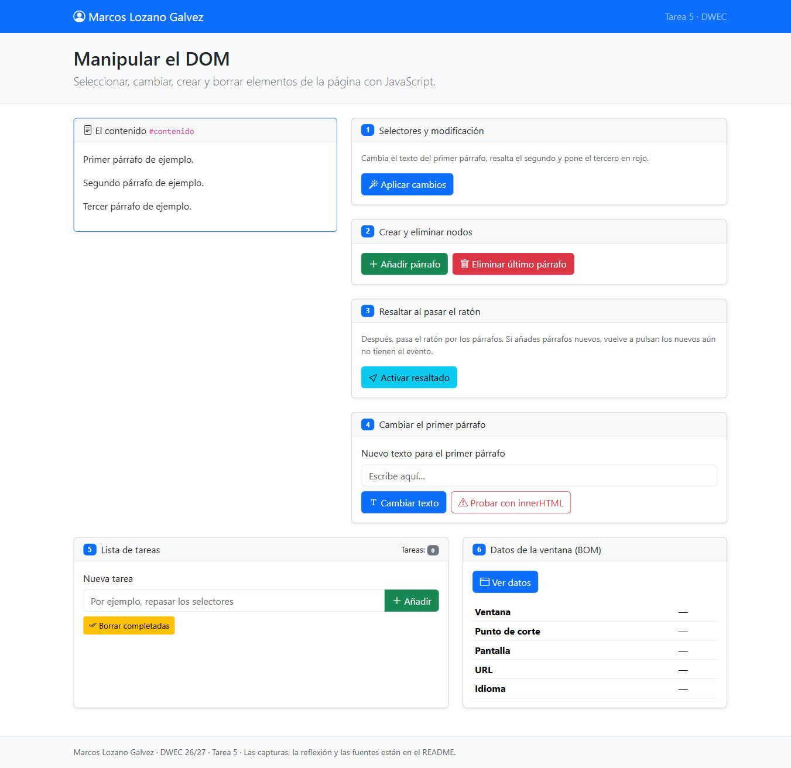
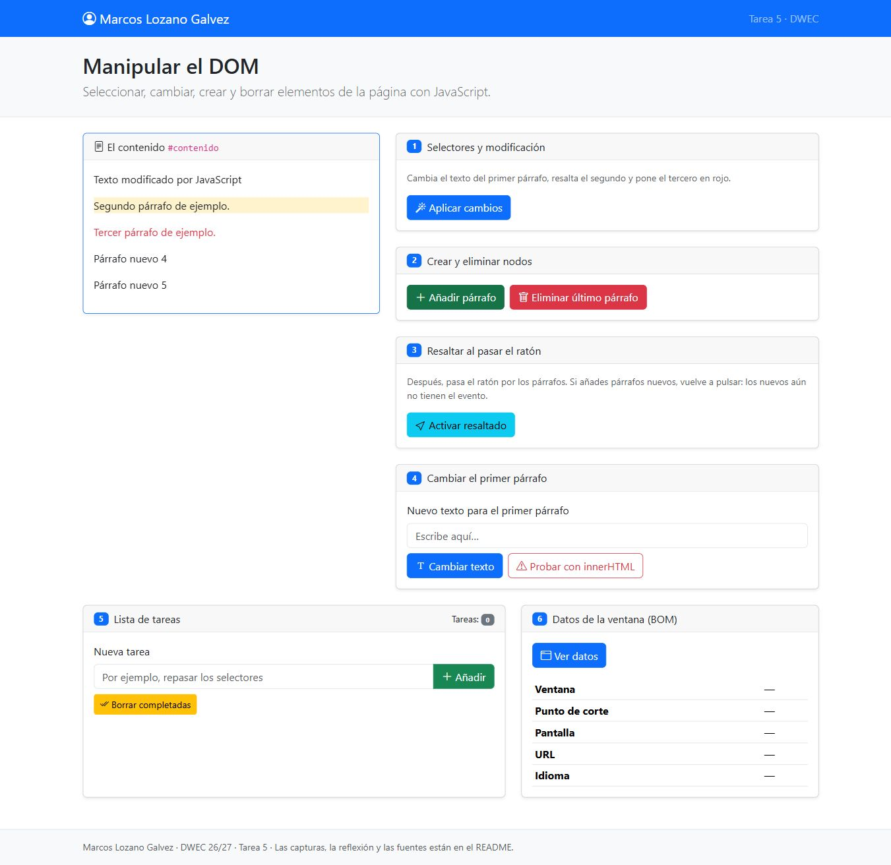
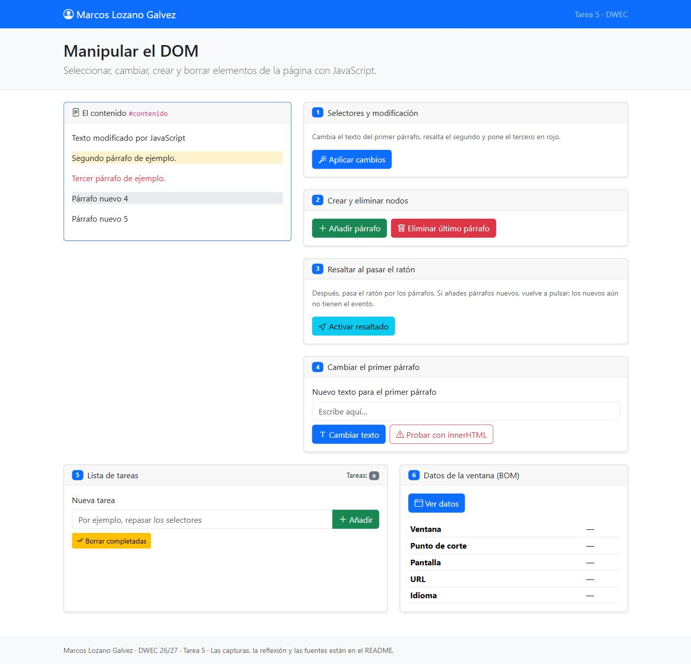
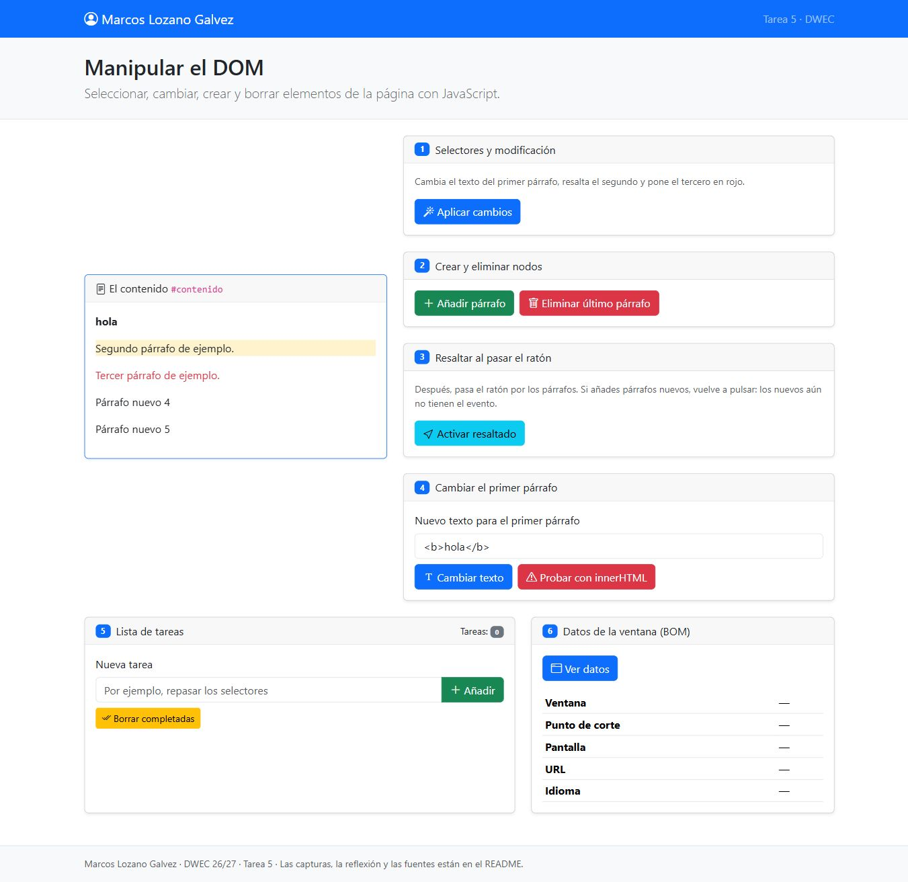
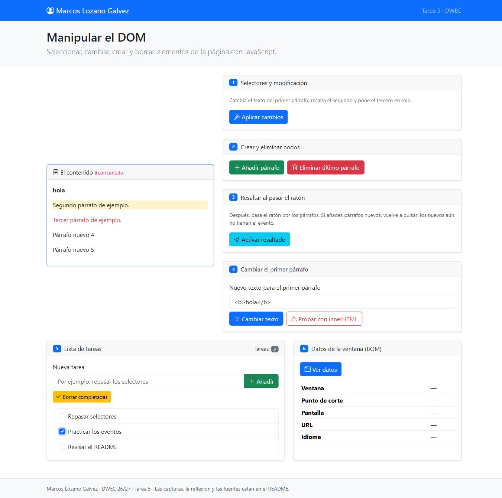
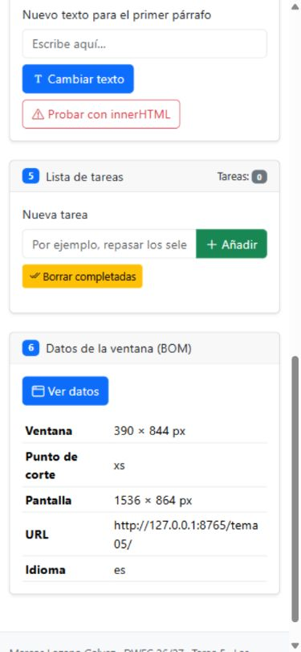

# Tarea 5 · Manipular el DOM

**Autor:** Marcos Lozano Galvez · DWEC · 2.º DAW · Curso 2026-27

Se completa la plantilla del profesor con seis ejercicios de DOM y BOM, manteniendo Bootstrap y `defer`.

## Instalación y pruebas

Abre `tema05/index.html` en el navegador o usa Go Live. Bootstrap necesita conexión. Abre F12 para ver los mensajes.

## Capturas

### a) Página inicial

Aparecen el nombre y los tres párrafos originales.

### b) Ejercicios 1 y 2

Se cambia el primero por ID, se resalta el segundo por clase y se colorea el tercero por posición. Se añaden los párrafos 4 y 5.

### c) Resaltado

El párrafo 4 queda gris al entrar el ratón. Los creados después necesitan pulsar otra vez: `querySelectorAll` devuelve una lista estática y los eventos solo se asignan a los párrafos encontrados.

### d) Prueba de HTML

Con `textContent` aparece literalmente `<b>hola</b>`; con `innerHTML`, hola en negrita.

### e) Tareas

Hay tres tareas, una marcada. Al borrarla, el contador pasa a dos.

### f) Tamaño móvil

La ventana simulada mide 390 × 844 y corresponde a xs; con 1366 píxeles corresponde a xl.

## Reflexión

`textContent` introduce texto literal. 
`innerHTML` interpreta etiquetas y crea elementos. 
Por eso `<b>hola</b>` solo produce negrita con el segundo. 
Interpretar entradas ajenas permite inyectar HTML o comportamientos peligrosos. 
Las tareas utilizan `textContent` para evitarlo. 
`innerHTML` se limita a la demostración del ejercicio.

## Fuentes

- [Plantilla del profesor](https://github.com/DRodero/DWEC_2627/tree/main/tema05_plantilla).
- MDN: [textContent](https://developer.mozilla.org/es/docs/Web/API/Node/textContent), [innerHTML](https://developer.mozilla.org/es/docs/Web/API/Element/innerHTML) y [querySelectorAll](https://developer.mozilla.org/es/docs/Web/API/Document/querySelectorAll).

## Uso de IA

ChatGPT/Codex ha completado el código, redactado este README y ejecutado pruebas y capturas automatizadas en el equipo. La revisión y explicación personal del alumno quedan pendientes antes de entregar.
