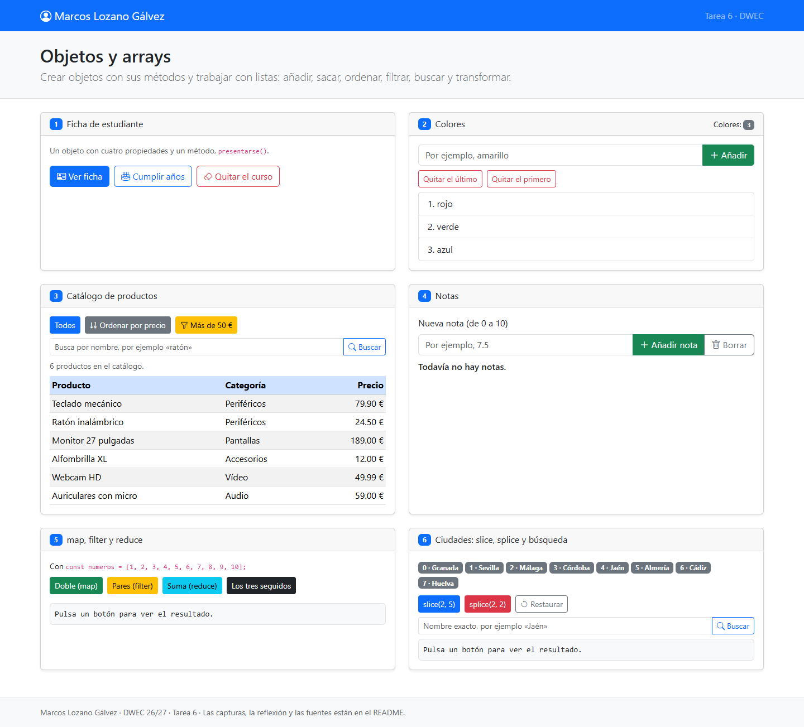
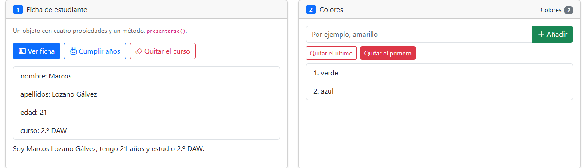
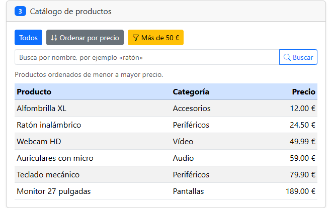
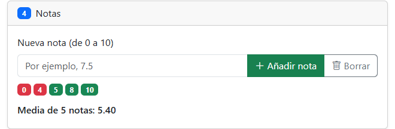
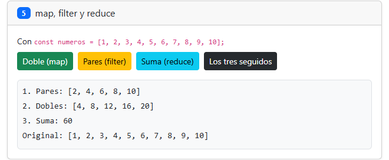
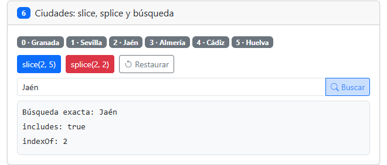

# Tarea 6 · Objetos y arrays

**Autor:** Marcos Lozano Gálvez · 2.º DAW · DWEC · Curso 2026-27

Página con seis ejercicios de objetos y arrays a partir de la plantilla del profesor. Para probarla, abre `index.html` en el navegador y la consola con F12. Bootstrap necesita conexión a Internet.

## Capturas

### a) Página recién cargada

El nombre aparece en la cabecera. Se cargan tres colores, seis productos y ocho ciudades.

### b) Ficha y colores

La ficha pasa de 20 a 21 años. Se añade amarillo con `push`, se quita con `pop` y se elimina rojo con `shift`: quedan verde y azul.
Al borrar `curso` con `delete`, su lectura devuelve `undefined` porque la propiedad ya no existe; también aparece en la presentación.

### c) Catálogo ordenado

La comparación `a.precio - b.precio` coloca primero la alfombrilla y al final el monitor. Se ordena una copia para conservar el catálogo original.

### d) Notas y media

Las notas 0, 4, 5, 8 y 10 tienen media 5.40. Los suspensos salen en rojo y los aprobados en verde. Se rechazan entradas vacías y notas fuera del intervalo.

### e) Métodos encadenados

`filter` selecciona los pares, `map` los duplica y `reduce` suma sus dobles: 60. Debajo sigue visible el array original.

### f) Ciudades y búsqueda

`splice(2, 2)` elimina Málaga y Córdoba. Jaén pasa del índice 4 al 2: `includes` devuelve `true` e `indexOf`, 2.

## Reflexión

`push`, `pop` y `shift` cambian el array sobre el que se ejecutan.  
`sort` y `splice` también modifican el original.  
`slice`, `map` y `filter` devuelven arrays nuevos.  
`reduce` acumula los elementos y aquí devuelve un número, sin cambiar el array.  
En ciudades, `slice(2, 5)` devuelve tres elementos y conserva las ocho ciudades.  
En cambio, `splice(2, 2)` elimina dos y desplaza las posiciones siguientes.  
En productos se ordena `[...productos]` para que «Todos» conserve el orden inicial.

## Fuentes

- [Plantilla del profesor](https://github.com/DRodero/DWEC_2627/tree/main/tema06_plantilla).
- [MDN: Array](https://developer.mozilla.org/es/docs/Web/JavaScript/Reference/Global_Objects/Array).
- [MDN: delete](https://developer.mozilla.org/es/docs/Web/JavaScript/Reference/Operators/delete).
- [MDN: createElement](https://developer.mozilla.org/es/docs/Web/API/Document/createElement).

## Uso de IA

Codex ha implementado el JavaScript, redactado este README y ejecutado comprobaciones y capturas locales. Marcos facilitó sus datos personales. La revisión personal del código y la preparación de la defensa quedan pendientes; este trabajo no se presenta como realizado sin ayuda.
