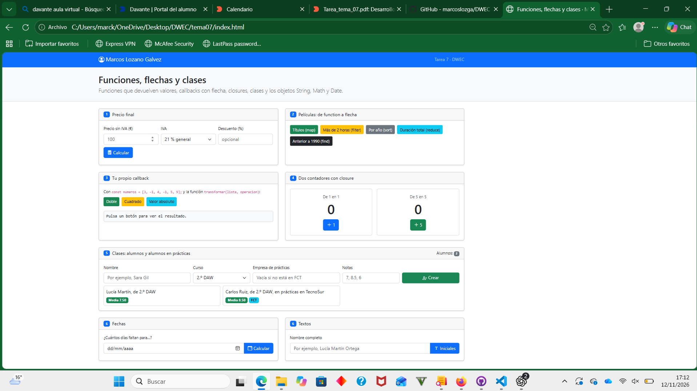
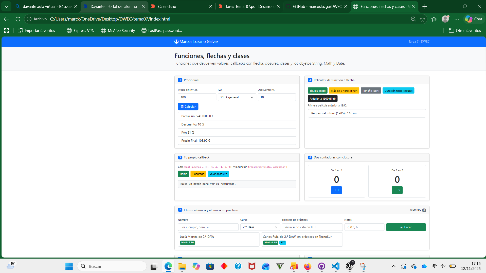
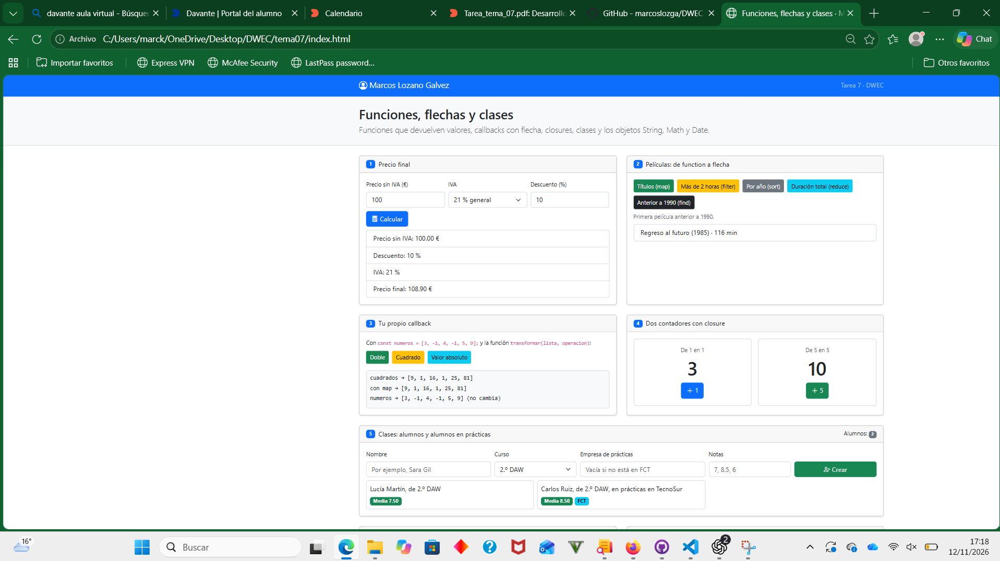
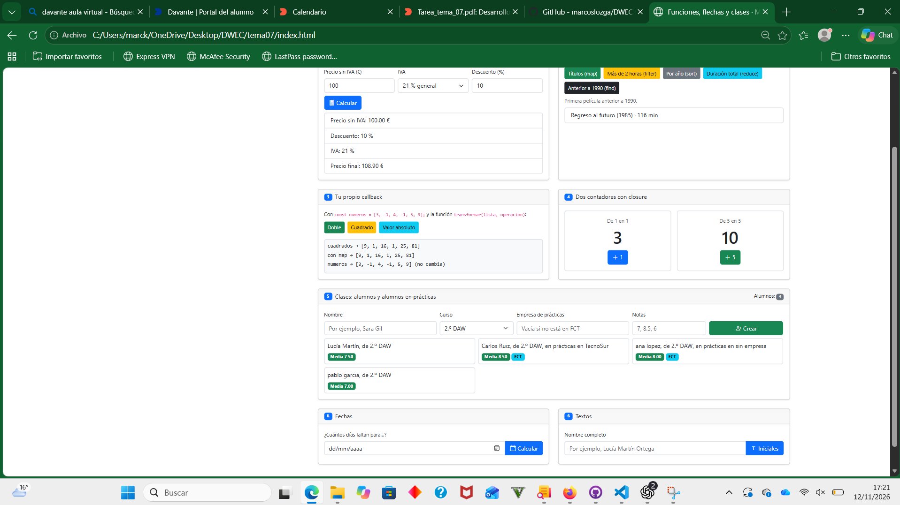

# Tarea 7 · Funciones, flechas y clases

**Autor:** Marcos Lozano Galvez · Desarrollo Web en Entorno Cliente (DWEC) · 2.º DAW · Curso 2026-27

En esta carpeta he trabajado con funciones, funciones flecha, callbacks, closures y clases en JavaScript. Para ver la práctica, abro `index.html` en el navegador y pruebo los botones. Con F12 puedo abrir la consola y ver los mensajes.

## Capturas

### a) La página recién cargada

En esta captura se ve la página al abrirla, mi nombre en la barra superior y los dos alumnos que aparecen desde el principio.

### b) Ejercicios 1 y 2: el precio y las películas

Se muestra un precio con descuento y el resultado de un botón de películas. La función `calcularPrecio()` calcula y devuelve el precio final; `mostrarPrecio()` lee los datos y muestra el resultado en la página.

### c) Ejercicios 3 y 4: tu callback y los contadores

La función `transformar()` recorre la lista, aplica una operación a cada elemento y guarda los resultados en un array nuevo. Cada contador tiene su propia variable `cuenta`, por eso funcionan de manera independiente.

### d) Ejercicio 5: los alumnos

Se ven cuatro alumnos, incluyendo alumnos en prácticas. Si el campo de empresa está vacío, el programa crea un `Alumno`; si contiene una empresa, crea un `AlumnoFCT`.

### e) Ejercicio 6: fechas y textos

Se muestra el cálculo de días hasta una fecha y las iniciales de un nombre. La diferencia de días se redondea con `Math.round()` porque los cambios de hora pueden hacer que la resta no dé un número entero.

## Reflexión

Al pasar un callback de `function` a una función flecha, el código puede escribirse de forma más corta.
Por ejemplo, uso `(pelicula) => pelicula.titulo` para obtener los títulos con `map`.
Cuando la flecha tiene una sola expresión y no lleva llaves, devuelve el resultado automáticamente.
Si utilizo llaves y quiero devolver un valor, tengo que escribir `return`.
En las clases he usado métodos con la forma corta, como `media()`, en lugar de funciones flecha.
Así los métodos tienen el comportamiento adecuado de `this` para trabajar con cada alumno.
También he comprobado que los dos contadores mantienen sus cuentas por separado.

## Fuentes

- [MDN: funciones flecha](https://developer.mozilla.org/es/docs/Web/JavaScript/Reference/Functions/Arrow_functions)
- [MDN: clases](https://developer.mozilla.org/es/docs/Web/JavaScript/Reference/Classes)
- [MDN: Date](https://developer.mozilla.org/es/docs/Web/JavaScript/Reference/Global_Objects/Date)

## Uso de IA

He utilizado ChatGPT para orientarme con la estructura del código, entender algunos conceptos y corregir errores. Después he ido incorporando los cambios a la práctica y comprobando su funcionamiento en el navegador.